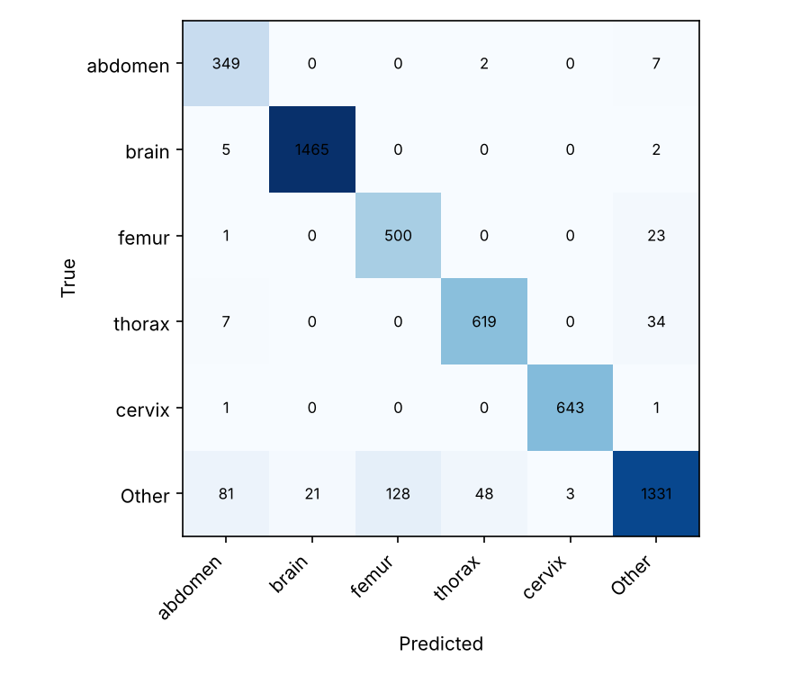
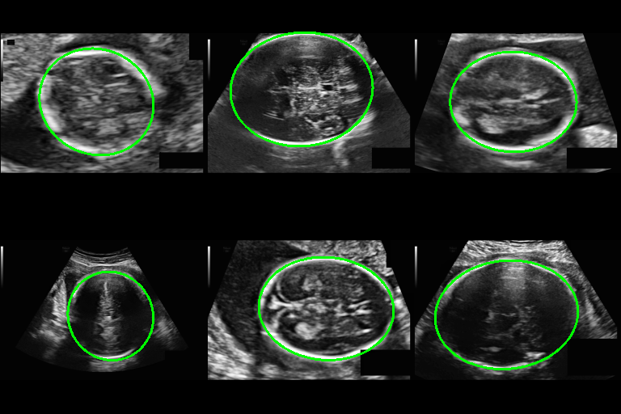
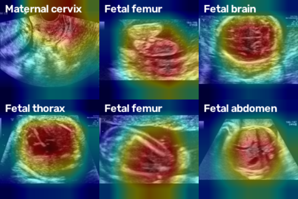
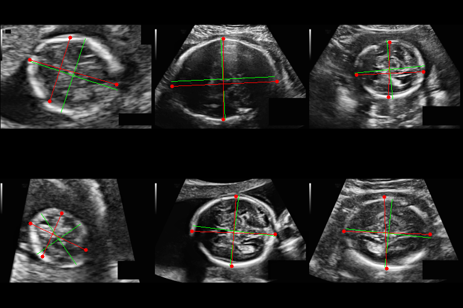

# FetalScan

Deep learning for fetal ultrasound: **standard-plane classification** and **automated head circumference (HC) measurement**, built in PyTorch with OpenCV and PIL, on two public datasets.

> Research and learning project on public, de-identified datasets. Not a medical device and not for clinical use.

| Task | Dataset | Model | Metrics |
|---|---|---|---|
| Plane classification (6 classes: abdomen, brain, femur, thorax, maternal cervix, other) | FETAL_PLANES_DB, about 12,400 images | ResNet-18 (ImageNet transfer, 1-channel input) | accuracy, macro F1, confusion matrix |
| Fetal head segmentation + HC biometry | HC18, 999 labeled training images | U-Net + OpenCV ellipse fit | Dice, HC MAE (mm), % within 3 mm, bootstrap 95% CI |
| Biometry landmark detection (BPD / OFD endpoints) | HC18 (points derived from ellipse labels) | U-Net + soft-argmax | mean radial error (mm), success rate, BPD/OFD length error |

## Results

Trained on CPU (4-core Xeon, no GPU). Test sets were never used for training, model selection or early stopping. Full numbers are in [`docs/results.json`](docs/results.json).

**Plane classification**: FETAL_PLANES_DB official test split, 5,271 images; ResNet-18, 160 px, 10 epochs

| Metric | Value |
|---|---|
| Test accuracy | **93.1%** |
| Test macro F1 | **0.924** |
| Per-class F1 | brain 0.991, cervix 0.996, thorax 0.932, other 0.884, abdomen 0.870, femur 0.868 |

Most errors come from the catch-all *Other* class (e.g. 128 *Other* frames predicted as femur); the five anatomical planes are rarely confused with each other.



**Head segmentation + head circumference**: HC18 held-out split, 151 images; U-Net at 256 px

| Metric | Value |
|---|---|
| Test Dice | **0.961** (95% CI 0.945 to 0.971) |
| HC mean absolute error | **2.59 mm** (95% CI 2.18 to 3.05 mm) |
| Within 3 mm of the reference HC | 72.9% |
| Ellipse-fit failures | 0 / 151 |

The U-Net was trained for 11 epochs, then resumed from the best checkpoint at a lower learning rate (5e-4) for 7 more epochs with early stopping, after a machine restart. HC18's official test labels are hidden behind the Grand Challenge leaderboard, so these numbers come from a 70/15/15 split of the labeled training set.



**Interpretability (Grad-CAM)**: labels are the model's predictions. The second panel is an *Other* frame the model calls femur, a typical failure.



**Ablations (plane classifier, same 5,271-image test set, 10 epochs each)**

| Variant | Test accuracy | Macro F1 |
|---|---|---|
| ImageNet-pretrained + CLAHE (baseline) | 93.1% | 0.924 |
| From scratch + CLAHE | 89.5% | 0.888 |
| ImageNet-pretrained, no CLAHE | **93.4%** | **0.930** |

Transfer learning matters (+3.6 accuracy points, +0.036 macro F1) even though ultrasound looks nothing like ImageNet. CLAHE contrast enhancement did *not* help the classifier: a small negative result that suggests the network already normalizes contrast, and that preprocessing borrowed from classical image analysis should be tested, not assumed.

**Segmentation: resolution and test-time augmentation (151 held-out HC18 images)**

| Model | HC MAE (mm) [95% CI] | Dice |
|---|---|---|
| U-Net 256 px | 2.59 [2.18, 3.05] | 0.961 |
| U-Net 256 px + flip TTA (**selected**) | **2.49** [2.11, 2.93] | **0.962** |
| U-Net 384 px (fine-tuned from 256) | 2.47 [2.09, 2.88] | 0.961 |
| U-Net 384 px + flip TTA | 2.51 [2.15, 2.92] | 0.961 |

The 256 px + TTA model was chosen on the validation split (val HC MAE 2.27 mm vs. 3.04 mm at 384 px); on test the four variants are within each other's confidence intervals. With 8 CPU epochs, higher resolution did not pay off; a GPU run training at 384+ from scratch is the obvious next experiment.

**Biometry landmark detection (BPD and OFD endpoints)**

HC18 provides ellipse outlines, not point labels, so the 4 landmarks are the endpoints of each annotated ellipse's minor axis (biparietal, BPD) and major axis (occipitofrontal, OFD), recomputed after every augmentation. A U-Net (encoder warm-started from the segmentation model) outputs one map per landmark; soft-argmax turns each map into sub-pixel coordinates, trained with an L1 loss that lets the two endpoints of an axis swap, since an axis has no natural direction. (A first version with plain heatmap MSE collapsed to all-zero maps; the coordinate loss fixed it.)

| Metric (151 test images) | Value |
|---|---|
| Mean radial error | 4.28 mm (95% CI 3.49 to 5.30) |
| Landmarks within 2 mm / 4 mm | 40.1% / 69.2% |
| BPD length error | **1.61 mm** |
| OFD length error | 2.31 mm |

Clinically the lengths matter most, and those are accurate; most point error comes from near-circular heads, where the direction of the major and minor axes is ill-defined (bottom-left below). Green = reference, red = prediction. Validation error was still falling at epoch 12, so a longer run should improve it.



**HC18 leaderboard submission**: [`docs/hc18_submission.csv`](docs/hc18_submission.csv) holds ellipse predictions for all 335 official test images (256 px U-Net + flip TTA, probability maps resized back to original resolution before the ellipse fit). The test labels are hidden, so the score only comes from uploading it at [hc18.grand-challenge.org](https://hc18.grand-challenge.org).

**Real-time inference** (ONNX Runtime, CPU, batch 1)

| Model | p50 latency | p95 latency | Throughput |
|---|---|---|---|
| Plane classifier (160 px) | 3.4 ms | 4.4 ms | about 300 frames/s |
| Head segmenter (256 px) | 47.7 ms | 60.5 ms | about 21 frames/s |

## How it works

```
ultrasound frame ──PIL load──► grayscale ──OpenCV CLAHE──► letterbox resize (keeps aspect ratio)
   │
   ├─► ResNet-18 ──► plane label + probabilities ──► Grad-CAM heatmap (interpretability)
   │
   └─► U-Net ──► head mask ──► largest contour ──► cv2.fitEllipse ──► Ramanujan perimeter × pixel size ──► HC (mm)
```

Design choices worth knowing:
- **Patient-level splits** for FETAL_PLANES_DB: frames from one scan look alike, so validation patients never appear in training (the official `Train` flag defines the test set).
- **Grayscale transfer learning**: the RGB conv1 weights of ImageNet ResNet-18 are averaged into one channel instead of discarded.
- **Class-weighted cross-entropy + label smoothing** for the imbalanced plane classes; early stopping on validation macro F1.
- **BCE + Dice loss** for segmentation (the head is a minority of pixels).
- **Aspect-preserving letterbox**: stretching an image would distort the ellipse and bias HC; pixel size is rescaled with the image.
- **Ellipse fit on the largest region** ignores small false-positive blobs; HC uses Ramanujan's perimeter approximation.
- **Validation with uncertainty**: per-image Dice and HC error with bootstrap 95% confidence intervals.
- **Real-time path**: models export to ONNX and run in ONNX Runtime behind a FastAPI service and a Streamlit demo, with p50/p95 latency measured.

## Run it

**On Colab (recommended, free T4 GPU):** open `colab_fetalscan.ipynb`, set the runtime to GPU, run all cells.

**Locally:**
```bash
pip install -r requirements.txt
bash scripts/download_data.sh                      # FETAL_PLANES_DB + HC18 from Zenodo
python scripts/resize_dataset.py --src data/FETAL_PLANES_ZENODO --dst data/FETAL_PLANES_256   # optional, much faster loading
python -m fetalscan.train_cls --data data/FETAL_PLANES_ZENODO --out runs/cls
python -m fetalscan.train_seg --data data/HC18 --out runs/seg
python -m fetalscan.tune --data data/FETAL_PLANES_ZENODO --trials 10      # optional Optuna search
python -m fetalscan.explain --ckpt runs/cls/best.pt --images some_image.png
python -m fetalscan.export --cls runs/cls/best.pt --seg runs/seg/best.pt --out exports
python -m fetalscan.train_landmarks --data data/HC18 --init-seg runs/seg/best.pt --out runs/landmarks
python -m fetalscan.eval_seg --data data/HC18 --ckpt runs/seg/best.pt --out runs/seg/eval.json      # with/without TTA
python -m fetalscan.hc18_submit --data data/HC18 --ckpt runs/seg/best.pt --tta --out hc18_submission.csv

# serve
FETALSCAN_CLS=exports/classifier.onnx FETALSCAN_SEG=exports/segmenter.onnx uvicorn app.serve:app
curl -F file=@frame.png "localhost:8000/measure-head?pixel_size_mm=0.15"
streamlit run app/streamlit_app.py -- --cls exports/classifier.onnx --seg exports/segmenter.onnx
```
Add `--mlflow` to either training command to log runs with MLflow, and `--resume` to continue from the last saved epoch after an interruption.

**Tests (CPU, no downloads):**
```bash
pytest -q
```
The suite covers ellipse math, mask filling, preprocessing, metrics, model shapes, Grad-CAM, and an end-to-end train → ONNX export → FastAPI run on synthetic images generated in the exact dataset layouts (`scripts/make_synthetic.py`).

## Layout
```
fetalscan/   preprocess.py  datasets.py  models.py  biometry.py  metrics.py  gradcam.py  landmarks.py
             train_cls.py   train_seg.py train_landmarks.py  tune.py  eval_seg.py  explain.py  export.py
             hc18_submit.py inference.py
app/         serve.py (FastAPI)   streamlit_app.py
scripts/     download_data.sh   make_synthetic.py
tests/       unit + end-to-end tests
```

## Datasets and citations

Check each dataset's license on its Zenodo page before redistributing anything; this repo does not include any images.

- **FETAL_PLANES_DB**: X. P. Burgos-Artizzu et al., "Evaluation of deep convolutional neural networks for automatic classification of common maternal fetal ultrasound planes," *Scientific Reports* 10, 10200 (2020). Zenodo record 3904280.
- **HC18**: T. L. A. van den Heuvel et al., "Automated measurement of fetal head circumference using 2D ultrasound images," *PLOS ONE* 13(8): e0200412 (2018). Zenodo record 1327317.
- U-Net: Ronneberger et al., 2015. Grad-CAM: Selvaraju et al., 2017.

## License
MIT (code only).
